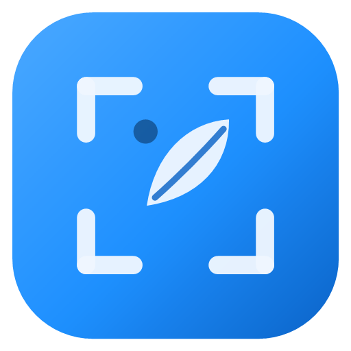

# Snapleaf

**Capture. Mark it. Share it.**

Snapleaf is a local-first screenshot studio for Windows. It recreates the workflow people
know from classic screenshot tools — press a hotkey, drag a region, annotate, then copy,
save, or share — with a clearer editor, a built-in gallery, and no account requirement.



> Snapleaf is an original implementation. It is not affiliated with, endorsed by, or
> distributed by Skillbrains/Lightshot. No Lightshot code, icons, translations, or other
> assets are included. See [docs/LIGHTSHOT-ANALYSIS.md](docs/LIGHTSHOT-ANALYSIS.md) for the
> read-only feature research that informed this project.

## Two ways to edit

1. **Inline, like a classic screenshot tool.** Select an area and keep the overlay open.
   Choose a **rectangle, ellipse, or freehand lasso** selection before dragging; the
   ellipse/lasso result keeps transparent pixels outside the shape. A **20px-thin,
   icon-only, square** tool rail attaches flush to the selection edge, with color/size
   panels, undo/redo, corner resize handles, and a compact action bar attached to the
   selection for Edit, Copy, Save, Share, Print, Redraw, Full screen, and Close.
   Both panes flip left/right/top when the selection approaches a screen edge.
   Active controls and the app mark use `#1E90FF`. Annotations are solid single-color
   strokes with no second outline or halo; the on-screen selection border remains dotted
   so it stays distinguishable from the captured content.
2. **In the full editor.** Click **Edit** (or press Enter) to hand the current crop —
   including any inline markup — to the larger editor for crop, zoom, more markup, and
   save/print/share.

Neither workflow requires saving first. Both write the same final image.

## Features

- **Capture** a region, a full display, an existing image, or import from disk.
- **Annotate inline**, while the selector is still on screen: pen, line, arrow, rectangle,
  ellipse, marker, text, auto-numbered steps, pixelate, an individual-annotation eraser,
  color, size, undo/redo, resize handles, and
  Edit/Copy/Save/Share/Print/Redraw/Full/Close — exactly where you selected.
- **Erase one item at a time.** The eraser removes only the stroke, shape, text, or numbered
  step you click; undo restores that one removal instead of rolling back the whole mosaic.
- **Or open the full editor** when you want more room, crop, zoom, and a larger canvas.
  Inline markup is carried into the editor as a flattened starting image.
- **Undo and redo**, clear markup, crop, zoom, and fit-to-window in the full editor.
- **Copy** the finished PNG, **Save** as PNG/JPEG, or **Print** from either workflow.
- **Share** with a built-in local image server: short page links, direct image links,
  QR code, and social/email share targets.
- **Update checks on launch**, with an in-app prompt and Windows notification when a newer
  release is published: Download update, Remind me later, or Skip this version.
- **Gallery** for captures and shared images, with search, open, reveal, and delete.
- **Global hotkeys** with a recorder and clear conflict diagnostics.
- **Tray app** with quick capture actions and launch-at-login.
- **Multi-monitor** aware region capture, per-display DPI handling, last-region memory.
- **Themes** (system/light/dark), JPEG quality, filename patterns, custom save folder.
- **Local-first**: no telemetry, no account, no cloud upload unless you explicitly share.

## Quick start (development)

Requirements: Windows 10+, Node.js 22.23.4+ (tested with Node 24.15.0), npm.

```powershell
npm install
npm run dev
```

The Electron binary may need its download step if your npm policy disables install
scripts:

```powershell
node node_modules/electron/install.js
```

## Build

```powershell
npm run build
npm run typecheck
npm test
```

Create a Windows installer:

```powershell
npm run dist
```

The NSIS installer is written to `dist/Snapleaf-<version>-Setup.exe`. An unpacked build is
available at `dist/win-unpacked/Snapleaf.exe`.

## Default shortcuts

| Action | Shortcut |
| --- | --- |
| Capture region | `PrintScreen` |
| Edit selection | `Enter` in the selector |
| Copy selection | `Ctrl+C` in the selector |
| Save selection | `Ctrl+S` in the selector |
| Share selection | `Ctrl+U` in the selector |
| Full screen | `F` in the selector |
| Cancel | `Esc` |
| Editor undo / redo | `Ctrl+Z` / `Ctrl+Shift+Z` |
| Editor copy / save / share / print | `Ctrl+C` / `Ctrl+S` / `Ctrl+U` / `Ctrl+P` |
| Selection shape (before dragging) | `R` rectangle, `O` ellipse, `L` freehand lasso |
| Tools | `P` pen, `L` line, `A` arrow, `R` box, `O` circle, `M` marker, `T` text, `S` step, `B` pixelate, `E` eraser, `C` crop |

Global shortcuts can be changed under **Settings → Shortcuts**. While the recorder is
listening, Snapleaf pauses its global shortcuts so the pressed combination reaches the
recorder — including PrintScreen. Bare PrintScreen may also require **Take over the Windows
Print Screen key** and one Windows sign-out/restart before it becomes available.

## Where your data lives

Snapleaf keeps everything under `%APPDATA%\Snapleaf`:

| Path | Contents |
| --- | --- |
| `captures\` | Editor screenshots and imported images |
| `uploads\` | Images shared through the built-in server |
| `library.json` | Gallery metadata |
| `settings.json` | Your preferences |
| `logs\snapleaf.log` | Local diagnostics |

The default save folder is `Pictures\Snapleaf` and can be changed in Settings.

## Sharing model

The built-in server listens on port `38473` (configurable) and creates links on your LAN:

```
http://192.168.x.x:38473/p/<id>   share page with Open Graph metadata
http://192.168.x.x:38473/i/<id>   direct image
```

To share outside your network, point a reverse proxy or tunnel at the port and set
**Settings → Sharing → Public base URL**. Snapleaf does not run a cloud service and does
not upload anything unless you press Share.

## Application updates

Snapleaf checks a JSON manifest on launch unless disabled in **Settings → Advanced**.
The default feed is:

```
https://rajatmalik.dev/snapleaf/latest.json
```

A newer version produces an in-app prompt plus a Windows notification with **Download
update**, **Remind me later**, and **Skip this version**. Download opens the release page
in the browser; Snapleaf does not install anything silently. See
[docs/UPDATE-FEED.md](docs/UPDATE-FEED.md) for the manifest format and publishing steps.

## Developer & references

Snapleaf is designed and built by **Rajat Malik**, a senior frontend architect and
engineering lead based in Gurgaon, India. The in-app **Settings → Developer** section
includes availability, services, contact links, and reference excerpts from product
managers, product owners, and project managers. The same details live in
[docs/DEVELOPER.md](docs/DEVELOPER.md).

- Portfolio: <https://rajatmalik.dev/>
- Hire / contact: <https://rajatmalik.dev/#contact>
- LinkedIn: <https://www.linkedin.com/in/errajatmalik/>
- GitHub: <https://github.com/malikrajat>

## Verification

- Unit tests: `npm test` (settings, filename tokens, geometry, URL classification,
  update manifests).
- Electron end-to-end: `node scripts/e2e.mjs` — launches a real Electron instance,
  captures rectangle, ellipse, and lasso regions, adds numbered steps, erases one step,
  exercises undo, opens the editor, draws an arrow, adds text, pixelates, tests clipboard
  image output, uploads, verifies the share page and gallery HTML, opens Settings and the
  Developer references, and exercises the update prompt with a local feed. Screenshots
  are written to `analysis/` (ignored by git).
- TypeScript: `npm run typecheck`.

## Project layout

```
src/main/        Electron main process: capture, tray, hotkeys, server, storage, IPC
src/preload/     Context-isolated bridge
src/renderer/    React UI: overlay, editor, gallery, settings, share page
src/shared/      Types, settings schema, formatting, geometry
scripts/         Icon generation, Electron E2E, desktop screenshot helper
docs/            Analysis, parity, REA setup, privacy, architecture, roadmap
resources/       Original app icon
```

## Known gaps

- Full-screen **quick** actions do not draw the synthetic cursor (region captures do).
- Region selection is per-display; cross-monitor drag selection is not yet supported.
- Rectangle/ellipse/lasso selection applies to capture. The full editor's Crop is still
  rectangular, and existing annotations can be erased but not moved or resized.
- The UI is English-only; the language layer is ready for community translations.
- The built-in server is LAN-only by default; public sharing requires your own tunnel/proxy.
- Update checks prompt and open the release page; silent auto-download/install and signed
  delta updates are not implemented yet.
- No code-signing certificate is configured yet.

See [docs/FEATURE-PARITY.md](docs/FEATURE-PARITY.md) and [docs/ROADMAP.md](docs/ROADMAP.md).

## License

MIT for Snapleaf-authored code. Third-party packages retain their own licenses. Lightshot
is a trademark of its owner and was used only as a behavioral reference on a locally
installed copy.
